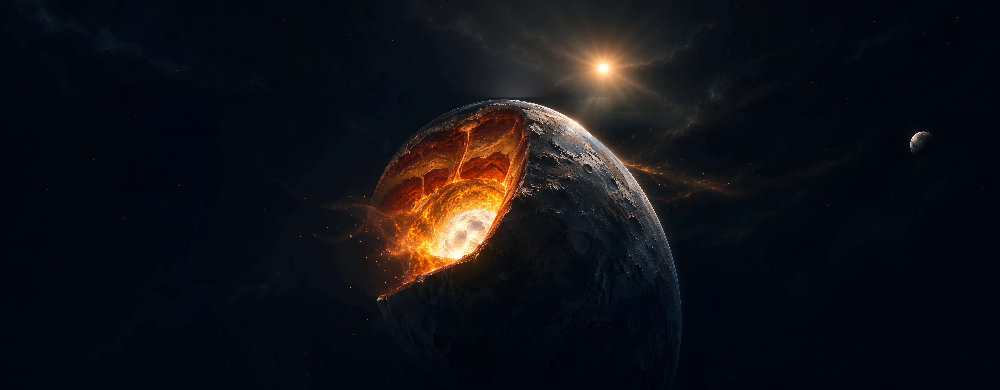

# Gargantuan

A dark theme for [Omarchy](https://omarchy.org) about the largest things a civilisation could build or meet. Deep-space surfaces, starlight text and an amber accent taken from the accretion disk of a black hole, with nine ultra-wide panoramic wallpapers of colossal structures in space.


## Install

From the Omarchy menu: press **Super + Space**, then **Install → Style → Theme**, and paste the repository URL when it asks:

```
https://github.com/thepixelgardener-create/omarchy-gargantuan-theme
```

Or straight from a terminal:

```sh
omarchy theme install https://github.com/thepixelgardener-create/omarchy-gargantuan-theme
```

Omarchy installs and activates the theme, generating application colors from `colors.toml`. Cycle wallpapers with **Super + Ctrl + Space**.

## Wallpapers

Nine scenes, the theme's namesake first and then a climb up the Kardashev scale, from a star in a bottle to a gate between galaxies. Click any image for the full **9840 × 3840** panoramic original.

| Gargantuan | Fusion |
| --- | --- |
| [](backgrounds/01-gargantuan.webp) | [](backgrounds/02-fusion.webp) |
| A supermassive black hole. Gravity bends the far side of its disk over and under the shadow, and the side rushing toward you burns brighter. | A star in a bottle: a band of hydrogen plasma floating through the inside of a fusion reactor, whose tiled walls curve away like an endless tunnel. |

| Core | Thalassa |
| --- | --- |
| [](backgrounds/03-core.webp) | [](backgrounds/04-ocean.webp) |
| A planet opened to its heart: crust, mantle, a molten outer core and a white-hot inner core. | A world with no land: one ocean all the way around, turning from day into night. |

| Tether | Giant |
| --- | --- |
| [](backgrounds/05-elevator.webp) | [](backgrounds/06-giant.webp) |
| A road to orbit: a hair-fine space elevator climbing out of the atmosphere at sunrise. | A ringed gas giant seen from inside its own asteroid belt. |

| Star Lifter | Dyson |
| --- | --- |
| [](backgrounds/07-lifter.webp) | [](backgrounds/08-dyson.webp) |
| Harvesting a star: a ring of machines pulls a twisting column of plasma out of its surface. | A star being enclosed: a Dyson sphere two-thirds built, its light escaping through the gaps. |

| Gate | |
| --- | --- |
| [](backgrounds/09-gate.webp) | |
| A gate between galaxies: through the ring, space folds into a tunnel to a distant spiral. | |

### Resolution and displays

Every wallpaper is a single seamless **9840 × 3840** WebP panorama. On a 16:9, 16:10 or portrait display, Omarchy crops cleanly around the subject in the middle; on ultrawides and multi-monitor setups, the extra width lets the scene continue across the full span. [ASSETS.md](ASSETS.md) records dimensions, provenance and how the panoramas were stitched.

## Palette checks

The palette is held to 30 checks covering contrast, simulated red–green separation and text over the wallpapers at the lock screen's and launcher's modeled opacity.

| Measurement | Recorded result |
| --- | --- |
| Main text on the background | 15.5:1 |
| Weakest terminal signal color | 6.07:1 |
| Selected text | 9.82:1 |
| Muted text on the background | 4.54:1 |
| Red vs green, deuteranopia | 0.128 (target 0.10) |

[DESIGN.md](DESIGN.md) explains where each color comes from: the accent is the accretion disk, the active window border runs blue to amber to red like the Doppler shift across it, and the signal colors are redshift, aurora, fusion plasma and the rest.

## Credits and license

The 36 source images were generated with the image tool built into OpenAI's Codex; [GENERATION.md](GENERATION.md) preserves every prompt and [ASSETS.md](ASSETS.md) their provenance and processing. The palette, the scripts and the written notes are original work.

Released under the [MIT license](LICENSE).
