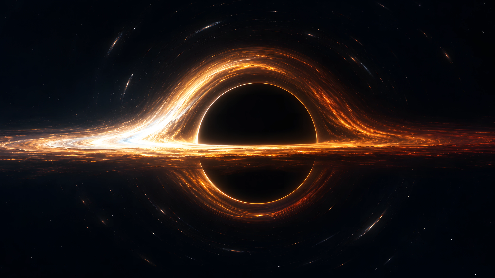
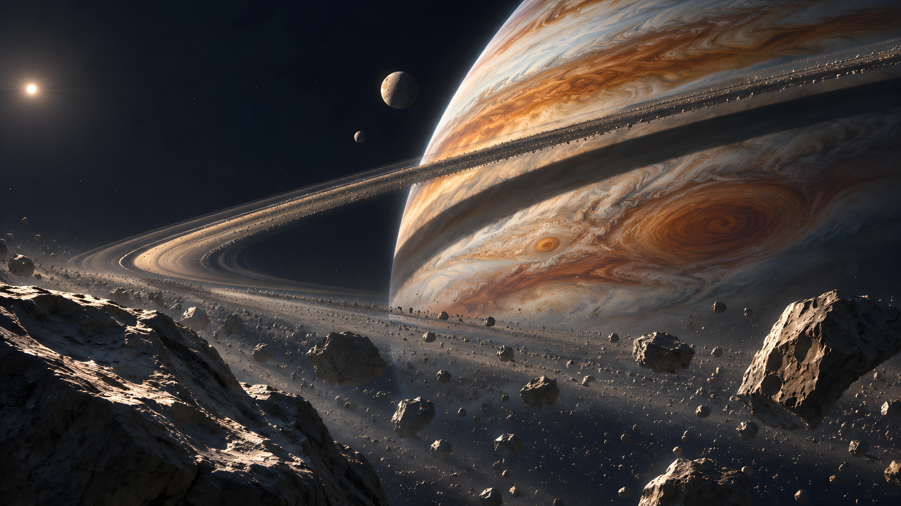
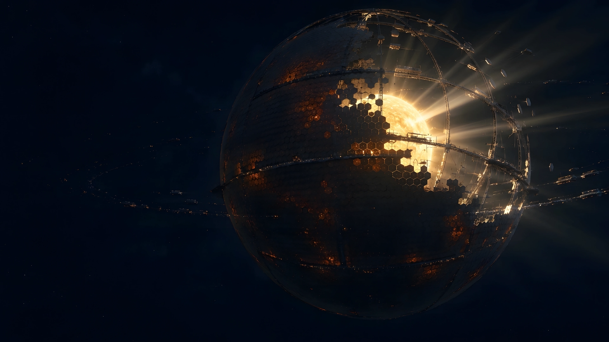
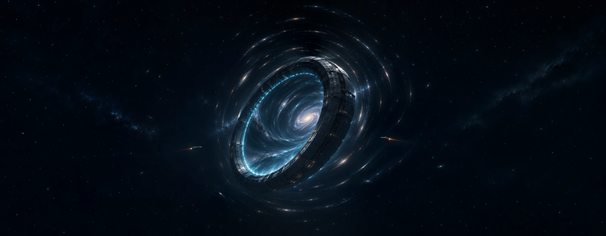
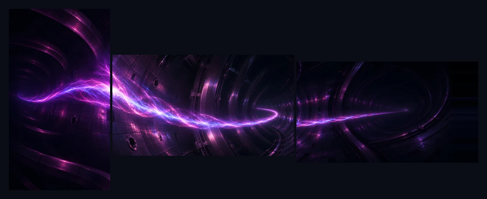
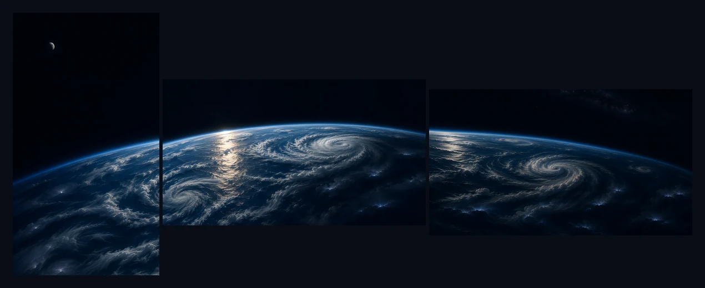

# Gargantuan

A dark theme for [Omarchy](https://omarchy.org) about the largest things a civilisation could build or meet. Deep-space surfaces, starlight text and an amber accent taken from the accretion disk of a black hole, with nine wallpapers of colossal structures in space. Every wallpaper also spans three monitors: with the [Multimonitor Background](https://github.com/thepixelgardener-create/omarchy-multimonitor-background) plugin each scene runs across all of them, continuing past the bezels.


*The black hole across three screens: the portrait panel, the wallpaper and the right panel, each at its monitor's position.*

## Install

From the Omarchy menu: press **Super + Space**, then **Install → Style → Theme**, and paste the repository URL when it asks:

```
https://github.com/thepixelgardener-create/omarchy-gargantuan-theme
```

Or straight from a terminal:

```sh
omarchy theme install https://github.com/thepixelgardener-create/omarchy-gargantuan-theme
```

Omarchy installs and activates the theme, generating application colors from `colors.toml`. Choose a wallpaper with **Super + Ctrl + Space**. On one screen, or without the plugin below, every wallpaper is an ordinary 4K wallpaper.

## Across three monitors

Omarchy shows the same wallpaper on every screen. Every Gargantuan wallpaper also has a left and a right panel in `backgrounds/spans/<name>/`, the parts of the scene beyond its edges. To show them, install the separate [Multimonitor Background](https://github.com/thepixelgardener-create/omarchy-multimonitor-background) plugin:

```sh
omarchy plugin add https://github.com/thepixelgardener-create/omarchy-multimonitor-background.git --enable
omarchy restart shell
```

The screen with the most pixels then shows the wallpaper and the screens directly to its left and right show its panels. Everything else, the background switcher, transitions, video wallpapers and other themes, works as before. The plugin's README explains how to switch back.

**The layout.** The panels were composed for a portrait screen on the left, a 16:9 main screen in the middle and a 16:9 screen on the right, as on the setup they were made on:

| Screen | Logical size | Position |
|---|---|---|
| Left, portrait | 1080 × 1920 | its centre 60 px above the main screen's centre |
| Main | 1920 × 1080 (a 4K screen at scale 2) | |
| Right | 1920 × 1080 | 70 px lower than the main screen |

Any two or three screens side by side get the panels too, but a screen shaped differently crops its panel to fill, so the scene lines up less exactly at that bezel. A layout with only two screens shows the wallpaper and the panel for the side the second screen is on.


## Wallpapers

Nine scenes, the theme's namesake first and then a climb up the Kardashev scale, from a star in a bottle to a gate between galaxies. Click a preview for the 4K original.

| Gargantuan | Fusion |
| --- | --- |
| [](backgrounds/01-gargantuan.webp) | [](backgrounds/02-fusion.webp) |
| A supermassive black hole. Gravity bends the far side of its disk over and under the shadow, and the side rushing toward you burns brighter. | A star in a bottle: a ribbon of violet plasma held by magnetic fields inside the torus of a fusion reactor. |

| Core | Thalassa |
| --- | --- |
| [](backgrounds/03-core.webp) | [](backgrounds/04-ocean.webp) |
| A planet opened to its heart: crust, mantle, a molten outer core and a white-hot inner core. | A world with no land: one ocean all the way around, turning from day into night. |

| Tether | Giant |
| --- | --- |
| [](backgrounds/05-elevator.webp) | [](backgrounds/06-giant.webp) |
| A road to orbit: a hair-fine space elevator climbing out of the atmosphere at sunrise. | A ringed gas giant seen from inside its own asteroid belt. |

| Star Lifter | Dyson |
| --- | --- |
| [](backgrounds/07-lifter.webp) | [](backgrounds/08-dyson.webp) |
| Harvesting a star: a ring of machines pulls a twisting column of plasma out of its surface. | A star being enclosed: a Dyson sphere two-thirds built, its light escaping through the gaps. |

| Gate | |
| --- | --- |
| [](backgrounds/09-gate.webp) | |
| A gate between galaxies: through the ring, space folds into a tunnel to a distant spiral. | |

### The spans

Each scene across three screens, with the panels at their monitors' positions.






### Resolution and displays

The wallpapers are **3840 × 2160** and the panels **2160 × 3840** (left) and **3840 × 2160** (right), upscaled from the generator's 1672 × 941 and 1024 × 1536 images. Ultrawide, 16:10 and portrait screens crop the wallpapers; the subject of each sits near the middle. [ASSETS.md](ASSETS.md) records dimensions, provenance and how the panels were aligned.

## Palette checks

The palette is held to 30 checks covering contrast, simulated red–green separation and text over the wallpapers at the lock screen's and launcher's modeled opacity.

| Measurement | Recorded result |
| --- | --- |
| Main text on the background | 15.5:1 |
| Weakest terminal signal color | 6.07:1 |
| Selected text | 9.82:1 |
| Muted text on the background | 4.54:1 |
| Red vs green, deuteranopia | 0.128 (target 0.10) |

[DESIGN.md](DESIGN.md) explains where each color comes from: the accent is the accretion disk, the active window border runs blue to amber to red like the Doppler shift across it, and the signal colors are redshift, aurora, fusion plasma and the rest.

## Credits and license

The 27 images were generated with the image tool built into OpenAI's Codex; [GENERATION.md](GENERATION.md) preserves every prompt and [ASSETS.md](ASSETS.md) their provenance and processing. The palette, the scripts and the written notes are original work.

Released under the [MIT license](LICENSE).
