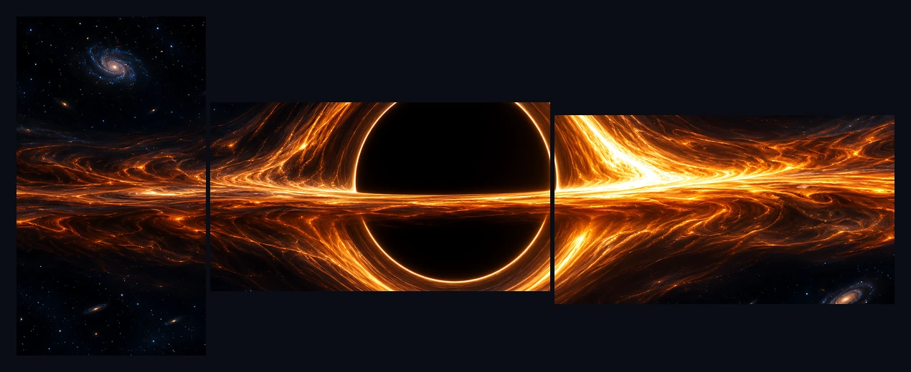
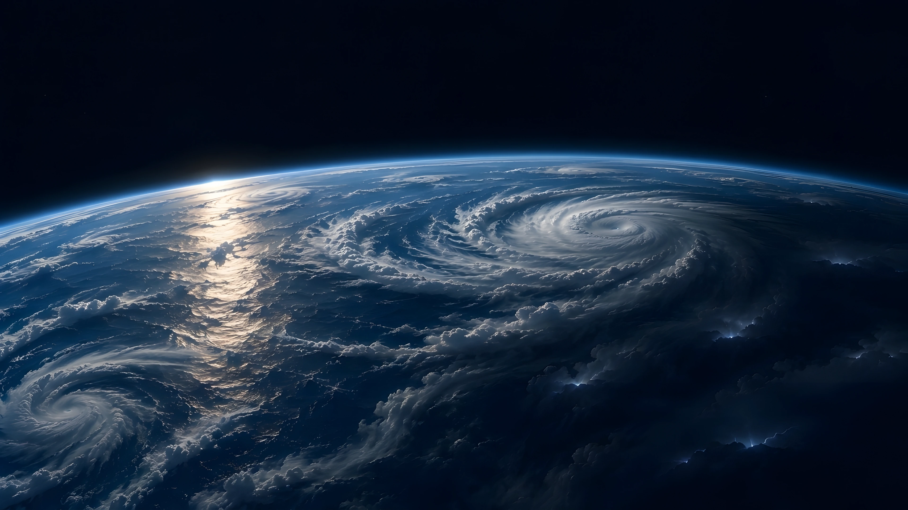
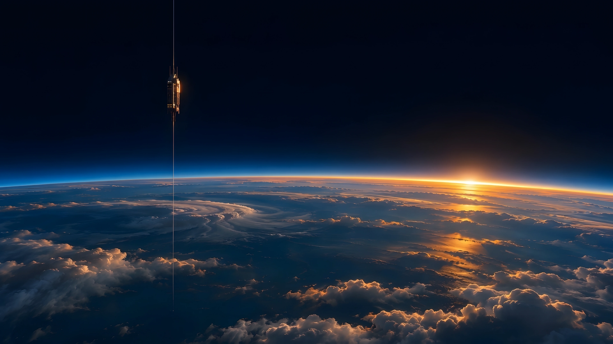
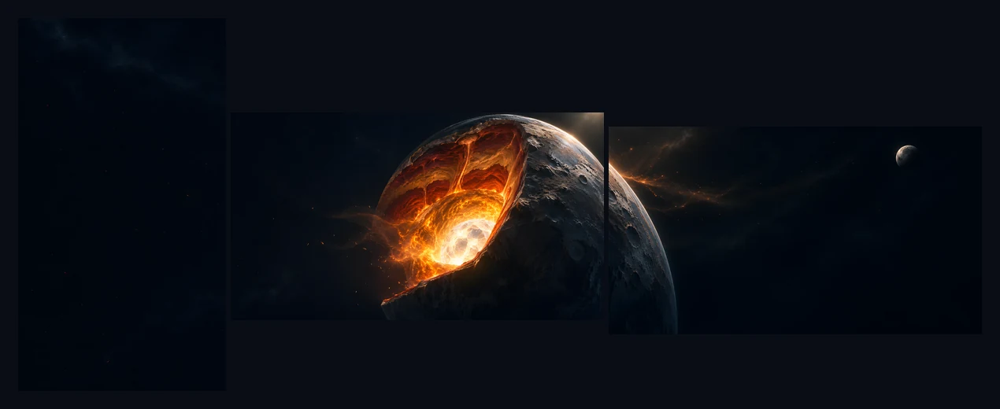
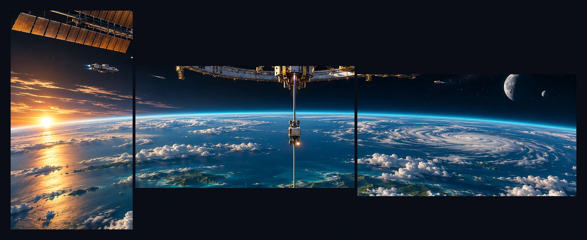
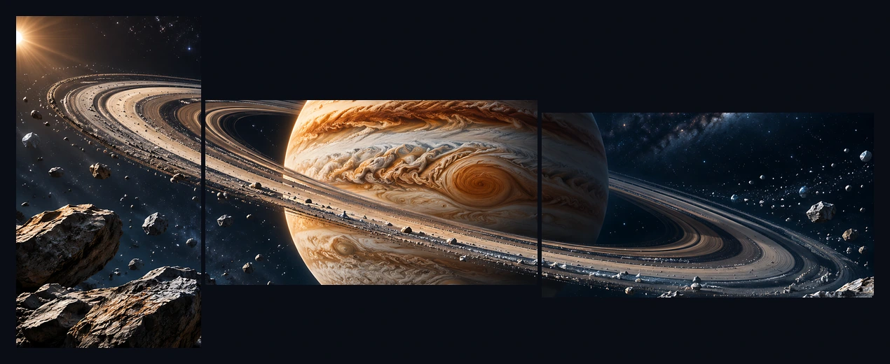
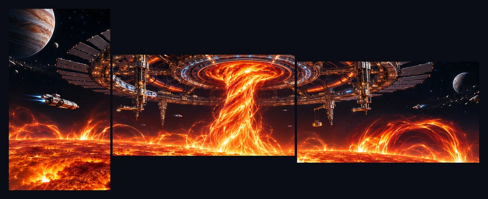
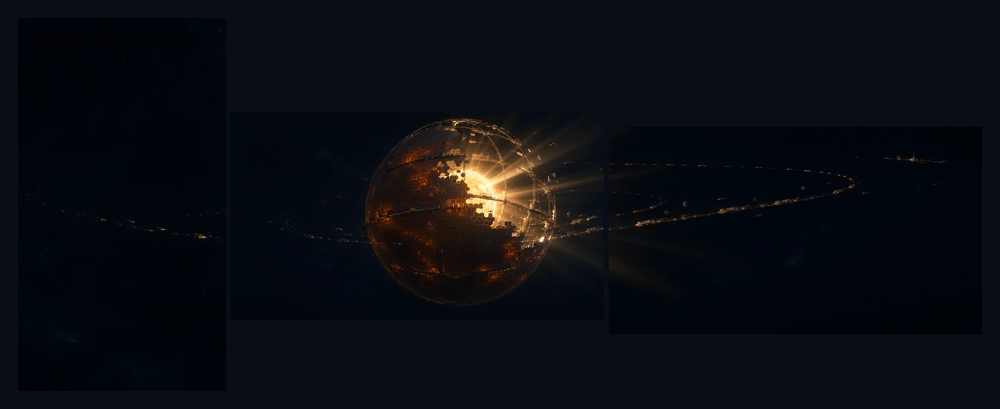
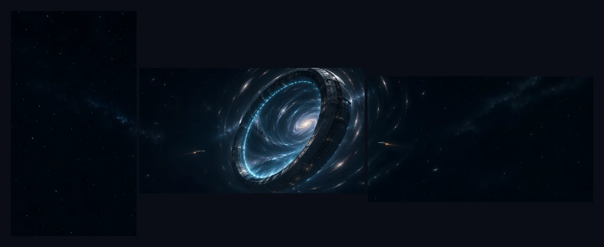

# Gargantuan

A dark theme for [Omarchy](https://omarchy.org) about the largest things a civilisation could build or meet. Deep-space surfaces, starlight text and an amber accent taken from the accretion disk of a black hole, with nine wallpapers of colossal structures in space. Every scene also comes as a panorama of three monitors, so with a spanning wallpaper tool such as [Station](https://github.com/Yakumy/Station) it runs across all of them, continuing past the bezels.



*The black hole's panorama across three screens, as Station spans it: each monitor shows the part of the scene at its position.*

## Install

From the Omarchy menu: press **Super + Space**, then **Install → Style → Theme**, and paste the repository URL when it asks:

```
https://github.com/thepixelgardener-create/omarchy-gargantuan-theme
```

Or straight from a terminal:

```sh
omarchy theme install https://github.com/thepixelgardener-create/omarchy-gargantuan-theme
```

Omarchy installs and activates the theme, generating application colors from `colors.toml`. Choose a wallpaper with **Super + Ctrl + Space**. The nine 4K wallpapers come first; the nine panoramas after them, named `span-…`, are for several monitors.

## Across three monitors

Omarchy shows the same wallpaper on every screen. Each scene therefore also comes as one panorama of a whole three-monitor layout, `backgrounds/span-<name>.webp`, for a wallpaper tool that spreads a single image across all screens. The [Station](https://github.com/Yakumy/Station) plugin does that:

```sh
omarchy plugin add https://github.com/Yakumy/Station.git --enable
```

Click the Station logo in the bar, open **Wallpaper**, choose **Span** and leave **Follow Omarchy wallpaper** on. Then pick a `span-` wallpaper with **Super + Ctrl + Space**, and Station spreads it over your monitors. To frame it differently, drag the monitor group in the Wallpaper tab or scroll to zoom; Station remembers the framing for each wallpaper.

**The preview layout.** The examples below use a portrait screen on the left, a 16:9 main screen in the middle and a 16:9 screen on the right, in Hyprland's logical pixels:

| Screen | Logical size | Position |
|---|---|---|
| Left, portrait | 1080 × 1920 | 0, 0 |
| Main | 1920 × 1080 (a 4K screen at scale 2) | 1080, 480 |
| Right | 1920 × 1080 | 3000, 550 |

Together that is 4920 × 1920, and each panorama is twice that, 9840 × 3840, the main screen's pixel density. Each panorama is one continuous composition with uniform processing across its full area. Station places your monitors over that scene; drag and zoom to choose the framing for your arrangement. The separate 4K wallpaper is a centred crop and differs from the main monitor's view in Span mode.

## Wallpapers

Nine scenes, the theme's namesake first and then a journey from a star in a bottle to a gate between galaxies. Click a preview for the 4K export; each scene's panorama is `span-` and the same name.

| Gargantuan | Fusion |
| --- | --- |
| [](backgrounds/01-gargantuan.webp) | [](backgrounds/02-fusion.webp) |
| A supermassive black hole, its shadow surrounded by a lensed disk of incandescent gas. | A star in a bottle: violet plasma inside a vast toroidal chamber, surrounded by tiled walls and intricate machinery. |

| Core | Thalassa |
| --- | --- |
| [](backgrounds/03-core.webp) | [](backgrounds/04-ocean.webp) |
| A planet opened to its heart: crust, mantle, a molten outer core and a white-hot inner core. | A world with no land: one ocean all the way around, turning from day into night. |

| Tether | Giant |
| --- | --- |
| [](backgrounds/05-elevator.webp) | [](backgrounds/06-giant.webp) |
| A road to orbit: a space elevator linking a monumental orbital station to the world below. | A ringed gas giant seen from among the rocks of its surrounding debris field. |

| Star Lifter | Dyson |
| --- | --- |
| [](backgrounds/07-lifter.webp) | [](backgrounds/08-dyson.webp) |
| Harvesting a star: an orbital collector draws a column of plasma from its surface. | A star being enclosed: an unfinished Dyson sphere, its light escaping through gaps in the hexagonal shell. |

| Gate | |
| --- | --- |
| [](backgrounds/09-gate.webp) | |
| A gate between galaxies: through the ring, space folds into a tunnel to a distant spiral. | |

### The panoramas

Each scene across three screens, as Station spans its panorama over the layout above.










### Resolution and displays

The wallpapers are **3840 × 2160** and the panoramas **9840 × 3840**, uniformly AI-upscaled from continuous panoramic sources of approximately 2007 × 783 pixels. These are export dimensions, not native capture resolution. Ultrawide, 16:10 and portrait screens crop the wallpapers; the subject of each sits near the middle. [ASSETS.md](ASSETS.md) records dimensions, provenance and processing.

## Palette checks

The palette is held to 30 checks covering contrast, simulated red–green separation and text over the wallpapers at the lock screen's and launcher's modeled opacity.

| Measurement | Recorded result |
| --- | --- |
| Main text on the background | 15.5:1 |
| Weakest terminal signal color | 6.07:1 |
| Selected text | 9.82:1 |
| Muted text on the background | 4.54:1 |
| Red vs green, deuteranopia | 0.128 (target 0.10) |

[DESIGN.md](DESIGN.md) explains where each color comes from: the accent is the accretion disk, the active window border runs blue to amber to red like the Doppler shift across it, and the signal colors are redshift, aurora, fusion plasma and the rest.

## Credits and license

The artwork was generated with the image tool built into OpenAI's Codex; [GENERATION.md](GENERATION.md) preserves every prompt and [ASSETS.md](ASSETS.md) their provenance and processing. The palette, the scripts and the written notes are original work.

Released under the [MIT license](LICENSE).
